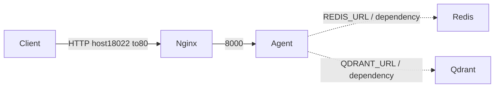

# Day 14 Lab — Mission Answers

**Học viên:** Trần Hữu Tài · **MSSV:** 2A202603944 · **Lớp:** K5-L3B  
**Ngày thực hiện:** 26/11/2026 · **Phạm vi:** Part 1–7 local; cloud chưa deploy theo yêu cầu.

## Part 1: Localhost vs Production

### Exercise 1.1 — Anti-patterns tìm thấy

Trong `01-localhost-vs-production/develop/app.py`:
1. Dòng 17–18 hardcode API key và database connection string: không thể rotate an toàn và dễ lộ qua Git; không chép giá trị vào bài.
2. Dòng 34 in key ra log: log aggregator cũng thành một nơi rò secret.
3. Dòng 21 bật DEBUG cố định, không tách môi trường.
4. Dòng 52 cố định port 8000, bỏ qua `PORT` do cloud cấp.
5. Dòng 51 bind `localhost`, không nhận kết nối qua network container như `0.0.0.0`.
6. Dòng 53 bật reload: phù hợp lúc sửa code, không phù hợp chạy production ổn định.
7. Không có `/health` và `/ready`: nền tảng không biết process sống hay dependency đã sẵn sàng.
8. Không có lifecycle cleanup/shutdown hook; không có lớp xác thực cho `/ask`.

### Exercise 1.2 — Chạy bản develop thật

Chạy bằng uvicorn không reload, đặt `PYTHONPATH` về gốc repo để tìm `utils`. Harness tự sở hữu PID và đóng process sau mỗi ví dụ: `python scripts/run_examples.py`.

```bash
curl -X POST 'http://127.0.0.1:18001/ask?question=Hello'
```

Output đã lưu trong `reports/examples.json`:
```json
{
  "status": 200,
  "body": {
    "answer": "Agent đang hoạt động tốt! (mock response) Hỏi thêm câu hỏi đi nhé."
  }
}
```

Gửi JSON thay vì query vào develop trả **422**, đúng chữ ký `question: str` của bản mẫu. Production nhận JSON và trả **200**; `/health` và `/ready` đều **200**. Không đánh đồng “HTTP chạy được” với production-ready.

### Exercise 1.3 — So sánh có giải thích

| Feature | Develop | Production mẫu | Vì sao quan trọng? |
|---|---|---|---|
| Config/secret | Hằng số trong code | `config.py`, `os.getenv`, validate | Một image chạy nhiều môi trường, secret có thể rotate ngoài Git |
| Health | Không có | `/health`, uptime, environment | Liveness giúp phát hiện process hỏng; dependency lỗi không nhất thiết phải restart process |
| Readiness | Không có | Cờ `is_ready`, `/ready` | Chỉ route traffic sau startup; Part 6 bổ sung kiểm tra Redis thật |
| Logging | `print`, in cả key | logging có cấu trúc dự kiến | Lọc/search sự kiện, không log secret; formatter mẫu bọc JSON bằng chuỗi chưa bảo đảm escaping, Part 6 dùng `json.dumps` thực sự |
| Shutdown | Không có lifecycle cleanup | `lifespan` startup/shutdown | Uvicorn ngừng nhận request mới, drain request đang chạy rồi đóng connection |
| Network | `localhost:8000` | host `0.0.0.0`, port từ env | Container/cloud truy cập được, không cố định port |
| Validation | Query string bắt buộc | Kiểm `question` trong JSON | Trả lỗi 422 rõ ràng thay vì lỗi khó hiểu |

## Part 2: Docker

### Exercise 2.1 — Trả lời theo Dockerfile thực tế

1. Base image develop là **`python:3.11`**, không phải `python:3.11-slim` trong đáp án ví dụ. Production có builder và runtime dùng slim.
2. Working directory: `/app`. Các lệnh sau `WORKDIR` và đường dẫn tương đối chạy từ đây.
3. `COPY requirements.txt` trước source cho phép cache layer cài dependency khi chỉ sửa code; đổi requirements mới phải cài lại.
4. `CMD` cung cấp lệnh/arguments mặc định, có thể thay bằng arguments sau tên image trong `docker run`. `ENTRYPOINT` chọn chương trình chạy; arguments thường được nối vào và có thể override bằng `--entrypoint`. Exec form giúp tiến trình nhận signal trực tiếp; shell wrapper phải dùng `exec` để không nuốt SIGTERM.

### Exercise 2.2 — Build và gọi container thật

Build từ **gốc repo**, vì `COPY` dùng đường dẫn tính từ gốc:
```bash
docker build -f 02-docker/develop/Dockerfile -t my-agent:develop .
docker build -f 02-docker/production/Dockerfile -t my-agent:advanced .
```

Bản develop chạy ở port18020; production ở18021. Bằng chứng: `reports/part2-develop-ask.txt` và `reports/part2-production-health.txt` (đều HTTP200). Toàn bộ là mock LLM local, không gọi dịch vụ trả phí.

### Exercise 2.3 — Kích thước đo trên máy này

Output `docker images my-agent` thật:
```text
REPOSITORY   TAG        SIZE
my-agent     advanced   240MB
my-agent     develop    1.67GB
```

Đồng thời giữ raw `docker image inspect` trong `reports/image-inspect.jsonl` và bản rút gọn `reports/image-sizes.json`:

| Image | `.Size` (bytes, inspect) | `.Size` / 1,000,000 (MB) |
|---|---:|---:|
| my-agent:develop | 426320416 | 426.320416 |
| my-agent:advanced | 57408989 | 57.408989 |

**Giảm 86.53%**, tính nhất quán bằng `(develop.Size - advanced.Size) / develop.Size × 100`. Docker29 trên máy này hiển thị `.Size` của inspect khác cột SIZE của images; giữ cả hai output, không trộn hai cột để tính phần trăm. Với SIZE đã làm tròn của `docker images`, cả production Part 2 (240MB) và Part 6 (286MB) đều dưới500MB. Checker Part6 dùng inspect và báo63MB (đơn vị chia1024², xem output gốc).

Builder cài/build dependency, có compiler; runtime chỉ copy kết quả cài package và source cần chạy. Slim và việc không mang compiler/build cache vào runtime làm image nhỏ hơn. Multi-stage tự nó không bảo đảm nhỏ nếu vẫn copy mọi thứ từ builder.

### Exercise 2.4 — Stack và test Nginx



Compose có agent, Redis, Qdrant và Nginx; Redis/Qdrant có healthcheck, agent chờ dependency healthy. **Endpoint mock Part2 chưa truy vấn Redis/Qdrant thực sự**; các mũi tên nét đứt là cấu hình dependency, không phải bằng chứng RAG chạy thật. Nginx là cổng truy cập ngoài, agent không publish trực tiếp trong stack.

Port80 bị Windows từ chối bind nên dùng override `scripts/compose.part2-ports.yml` (18022), không dừng dịch vụ khác:
```bash
docker compose -p k5-day14-docker -f 02-docker/production/docker-compose.yml -f scripts/compose.part2-ports.yml up -d --build
curl -i http://localhost:18022/health
curl -i -X POST http://localhost:18022/ask -H 'Content-Type: application/json' -d '{"question":"Explain microservices"}'
```

Hai lệnh trả200; output nguyên văn tại `reports/part2-nginx-health.txt` và `reports/part2-nginx-ask.txt`. File `.env.local` dùng cho ví dụ để trống, đã bị Git ignore; không thêm credential.

## Part 3: Cloud Deployment

### Exercise 3.1 — Railway / Render

**Public URL:**

**Chưa deploy, chưa đăng nhập cloud và chưa có ảnh cloud**, đúng phạm vi Tai giao. Khung cấu hình, biến môi trường và bốn lệnh tự kiểm có trong [DEPLOYMENT.md](DEPLOYMENT.md). Không lấy localhost hoặc ảnh Grafana thay cho URL/ảnh cloud. Phần điểm deploy thực tế chưa đạt.

### Exercise 3.2 — So sánh railway.toml với render.yaml

| Mục | Railway | Render |
|---|---|---|
| Định dạng/phạm vi | TOML cấu hình service: `[build]`, `[deploy]` | YAML Blueprint liệt kê `services`, `envVars` |
| Build | `builder="DOCKERFILE"`, Dockerfile trong root directory service | `runtime: docker`, `rootDir`, `dockerfilePath` |
| Liveness | `healthcheckPath="/health"` | `healthCheckPath: /health` |
| Secret | Đặt trên Variables/dashboard, không ghi giá trị vào TOML | `generateValue: true` hoặc `sync: false`, không dùng plaintext `value` cho key |
| Redis | Cấp Redis rồi tham chiếu REDIS_URL qua variables | Tự cấp Redis và nhập REDIS_URL; Blueprint hiện tại chưa tạo Redis |
| Port | Dùng PORT nền tảng cấp, CMD của image có `${PORT:-8000}` | Cùng cơ chế PORT trong CMD |

Khác nhau do Railway tách service/variables trong project, còn Blueprint Render mô tả cấu hình triển khai bằng danh sách YAML. Hai file hiện ở `06-lab-complete/`; hướng dẫn root directory nằm trong DEPLOYMENT.md.

### Exercise 3.3 — Pipeline Cloud Run (4 dòng)

1. `cloudbuild.yaml` bắt đầu bằng cài requirements và chạy pytest; bước build khai báo `waitFor: [test]`.
2. Build Docker image, gắn tag commit SHA và `latest`, sử dụng cache từ image trước rồi push tất cả tag lên registry trong cấu hình mẫu.
3. Deploy image theo commit SHA lên Cloud Run tại `asia-southeast1`, giới hạn1–10 instance, CPU/memory/timeout và lấy secret qua Secret Manager.
4. `service.yaml` là định nghĩa service khai báo image, env/secret, concurrency80, scaling và probes `/health`/`/ready`; có thể dùng `gcloud run services replace` thay vì tự bấm dashboard. Chỉ đọc cấu hình, chưa chạy GCP.

Lưu ý review: block test mẫu không dùng `set -e` và có `echo` sau pytest; để dùng CI thật cần bảo đảm pytest fail làm step fail, không chỉ dựa vào thứ tự `waitFor`. Không sửa file đề bài ngoài phạm vi.

## Part 4: API Security

### Exercise 4.1–4.3 — Output HTTP thật

Harness `scripts/run_examples.py` khởi động đúng source mẫu, gọi `curl -i`, lấy JWT từ `/auth/token` bằng tài khoản demo của repo, chỉ giữ token trong RAM. Không log response chứa token.

**Không có API key:**
```http
HTTP/1.1 401 Unauthorized
date: Thu, 26 Nov 2026 15:25:17 GMT
server: uvicorn
content-length: 67
content-type: application/json

{"detail":"Missing API key. Include header: X-API-Key: <your-key>"}
```

**Có API key hợp lệ (giá trị không đưa vào bài):**
```http
HTTP/1.1 200 OK
date: Thu, 26 Nov 2026 15:25:17 GMT
server: uvicorn
content-length: 114
content-type: application/json

{"question":"Hello","answer":"Agent đang hoạt động tốt! (mock response) Hỏi thêm câu hỏi đi nhé."}
```

**JWT student, sau10 request thành công:**
```http
HTTP/1.1 429 Too Many Requests
date: Thu, 26 Nov 2026 15:25:19 GMT
server: uvicorn
x-ratelimit-limit: 10
x-ratelimit-remaining: 0
x-ratelimit-reset: 1795706779
retry-after: 59
content-length: 98
content-type: application/json
x-content-type-options: nosniff
x-frame-options: DENY
x-xss-protection: 1; mode=block
referrer-policy: strict-origin-when-cross-origin

{"detail":{"error":"Rate limit exceeded","limit":10,"window_seconds":60,"retry_after_seconds":59}}
```

Vòng20 request ghi trong `reports/examples.json`: `[200, 200, 200, 200, 200, 200, 200, 200, 200, 200, 429, 429, 429, 429, 429, 429, 429, 429, 429, 429]`. Token endpoint trả200. API key mẫu Part4 trả403 cho key sai; **Part6 đã tuân hợp đồng chặt hơn: thiếu/sai đều401**.

- Key được đọc trong `verify_api_key` qua header `X-API-Key`. Rotate bằng cập nhật secret env và rolling restart; cần thiết kế giai đoạn chấp nhận key cũ/mới nếu muốn chuyển đổi không gián đoạn, bản lab chỉ hỗ trợ một key.
- JWT chứa subject, role, issued-at, expiry và chữ ký; server kiểm tra chữ ký và hạn dùng trước khi dùng role. Không tin role do client tự khai báo ngoài token đã xác minh.
- Rate limiter mẫu Part4 dùng deque timestamps trong60s: sliding-window log (không phải token bucket), student10/phút, teacher/admin100/phút. Admin **không miễn hoàn toàn**; muốn bypass phải có chính sách server rõ ràng sau xác thực, không chỉ thêm query parameter.
- Limiter/cost guard mẫu Part4 còn ở RAM nên không phù hợp nhiều worker. Part6 dùng Redis Lua atomic, không reset giới hạn khi worker/process khởi động lại.

### Exercise 4.4 — Cost guard

Rate limit bảo vệ tốc độ; cost guard bảo vệ tiền, vì mỗi request có thể dùng lượng token/model khác nhau. Trong Part6: ledger Redis theo UTC day/month, kiểm ngân sách trước LLM, tính cost từ token ước tính sau response và cộng atomic vào cả hai ledger; key kỳ mới tự tách state, TTL dọn ledger cũ. Monthly default10USD; daily1USD, cả hai đọc env. Hết ngân sách trả402, Redis lỗi trả503 (fail closed). Các con số giá là **giá mô phỏng của bài lab**, không phải giá API hiện hành.

Hai bài test40 lời gọi song song kiểm limiter không vượt10 lượt và ghi ledger không vượt ngân sách. Mock chỉ trả text nên token dùng `max(1,len(text)//4)`, không giả là token billing thật. Nếu nối provider thật: phải dùng token usage của provider và reservation/refund trước call để giới hạn cả chi phí đang in-flight, thay vì xem ledger sau call là hard cap bill tuyệt đối.

## Part 5: Scaling & Reliability

### Exercise 5.1 — Liveness khác readiness

`/health` nói process còn chạy; `/ready` nói dependency/khởi tạo đã đủ để nhận traffic. Redis chết thì Part6 `/health` vẫn200, `/ready`503, `/ask`503 thay vì âm thầm bỏ kiểm soát chi phí. Restart app liên tục khi Redis chết không sửa được Redis và dễ tạo restart storm.

### Exercise 5.2 — Graceful shutdown

Uvicorn sở hữu SIGTERM, ngừng accept kết nối mới rồi drain request đang xử lý. Cleanup connection đặt trong `lifespan`, không thay signal handler của uvicorn. Dockerfile dùng `sh -c "exec uvicorn ..."` nên uvicorn là PID1. Checker Linux thật xác minh request in-flight vẫn200, process exit0; `docker stop` exit0 trong0.6s. Đây là kiểm chứng Part6; không gán kết quả đó cho signal handler mẫu Part1.

### Exercise 5.3–5.5 — Stateless, balancing và history thật

```bash
# .env.local để trống, không có credential
docker compose -p k5-day14-scaling -f 05-scaling-reliability/production/docker-compose.yml up -d --build --scale agent=3
python 05-scaling-reliability/production/test_stateless.py
```

Stack mẫu Part5 dùng port8080 và `POST /chat`, **không phải `/ask` port80**. Output nguyên bản: [reports/stateless.txt](reports/stateless.txt). Năm request được chia qua ba instance `instance-627ca1`, `instance-9b9621`, `instance-e5509d`; history vẫn đủ10 messages (user+assistant). Script chỉ chứng minh chia tải và history chung, **không tự kill random instance**. Không tuyên bố đã chạy kịch bản kill nếu chưa chạy.

Lưu state trong RAM sẽ chia thành ba bản riêng và mất khi process chết; Redis dùng chung giúp request tiếp theo đến instance khác vẫn thấy state. Redis cũng cần persistence/backup và HA thực sự; stateless app không đồng nghĩa Redis không thể hỏng. Riêng rate-limit Part6 đã kiểm restart agent vẫn429 bằng checker.

## Part 6: Output check_production_ready.py

**Không sửa checker.** Git blob hiện tại và HEAD cùng `24d7f905fba9010e9c225d4fe98a23e3848cc40a`. Chạy bản đầy đủ trong Linux container vì Python Windows bỏ qua SIGTERM:

```bash
docker build -f scripts/Dockerfile.checker -t day14-checker:local 06-lab-complete
docker run --name day14-full-check --network host -v "$(pwd -W):/workspace" -v /var/run/docker.sock:/var/run/docker.sock day14-checker:local
```

Runner có Docker CLI và socket để checker build/chạy container thật. Chỉ dùng runner tin cậy trên máy lab; **agent ứng dụng không mount Docker socket**. Linux/WSL đã có Python+dependency thì có thể chạy `python check_production_ready.py` trực tiếp trong `06-lab-complete/`.

Trích nguyên phần checklist từ [output đầy đủ](reports/production-readiness.txt):
```text
📋 Checklist Deliverable
     ✅ Dockerfile (multi-stage, < 500 MB)
     ✅ docker-compose.yml (agent + redis)
     ✅ .dockerignore
     ✅ Health check endpoint (GET /health)
     ✅ Readiness endpoint (GET /ready)
     ✅ API Key authentication
     ✅ Rate limiting
     ✅ Cost guard
     ✅ Config từ environment variables
     ✅ Structured logging
     ✅ Graceful shutdown
     ✅ Public URL ready (Railway / Render config)
----------------------------------------------------------------
  Result: 12/12 tiêu chí đạt · 43/43 checks passed
  🎉 PASS 12/12 — PRODUCTION READY! Deploy nào!
================================================================
```

## AI log — Khai báo hỗ trợ

Có dùng **AI coding assistant (Hermes, profile coder2)** hỗ trợ đọc rubric/hợp đồng, viết Part6, thêm tests, chạy lệnh local, đo benchmark, debug Docker/Jaeger, chụp UI và soạn tài liệu từ JSON/CSV. Các đoạn giải thích và code trong bài có AI hỗ trợ, không khai là tự viết hoàn toàn.

Tất cả số đo và output trong bài lấy từ lệnh/API đã chạy trên máy; không tự đặt số, không dùng đáp án mẫu làm số đo. Lỗi gặp thật: Windows bỏ qua SIGTERM; teardown socket khi restart Python nhanh; thiếu PYTHONUSERBASE ở image Part7; port80 bị từ chối; Jaeger bản này dùng APIv3; Compose run tự đưa replicas về default2 nên phải đo lại với `--no-deps`. Chưa có review/duyệt cuối của Tai hoặc Lab Coach.

## Phần còn thiếu / lưu ý bàn giao

- Cloud deployment, URL public và ba ảnh cloud chưa làm theo yêu cầu; xem DEPLOYMENT.md.
- Chưa commit/push, chưa thay trạng thái public repo hoặc nộp LMS.
- Docker cleanup bị approval policy chặn trong headless session. Không lách policy; danh sách tài nguyên của task và lệnh để người có quyền dừng sẽ nằm trong `reports/cleanup-required.md`. Browser và Python harness có đóng process/context của mình.
